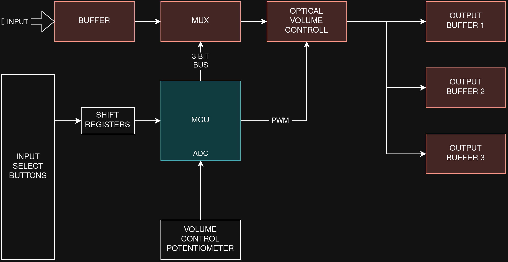

## Audio Input Switcher

### To-Do

- [x] Design powersupply PCB
- [x] Order powersupply PCB
- [ ] Populate powersupply PCB
- [ ] Test prototype with powersupply PCB

- [ ] Design mainboard PCB
- [ ] Order mainboard PCB
- [ ] Populate mainboard PCB
- [ ] Test mainboard

- [x] Write prototype code for the ATmega328P
- [ ] Map volume control nonlinearity
- [ ] Write final version code for the ATmega328P
- [ ] Construct device chassis

Simplified block diagram:

